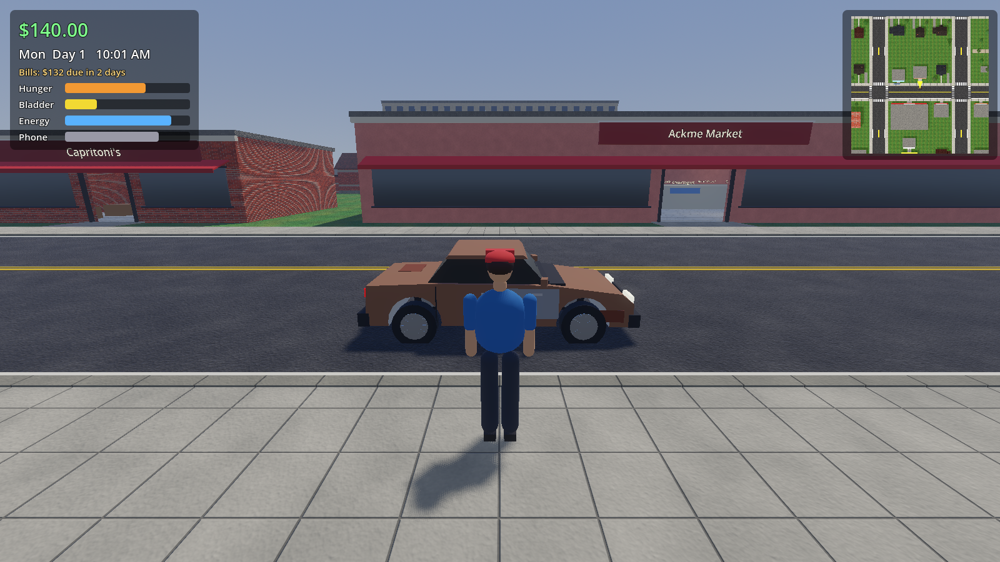
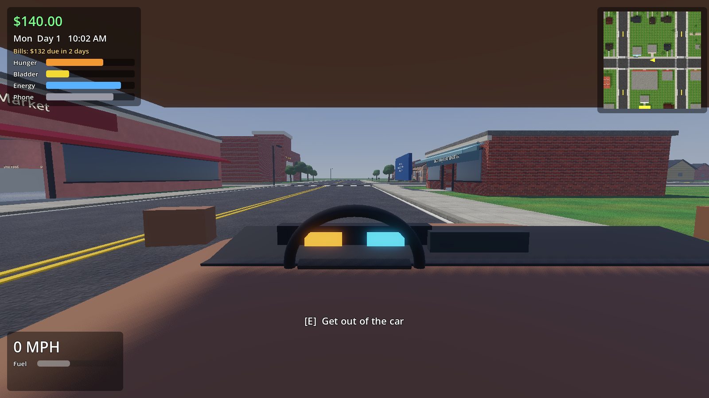
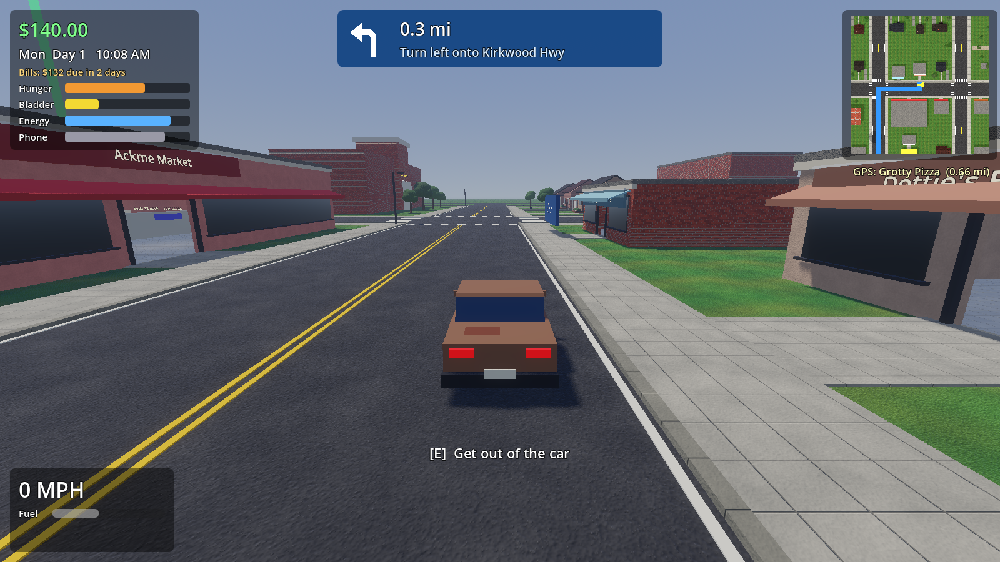
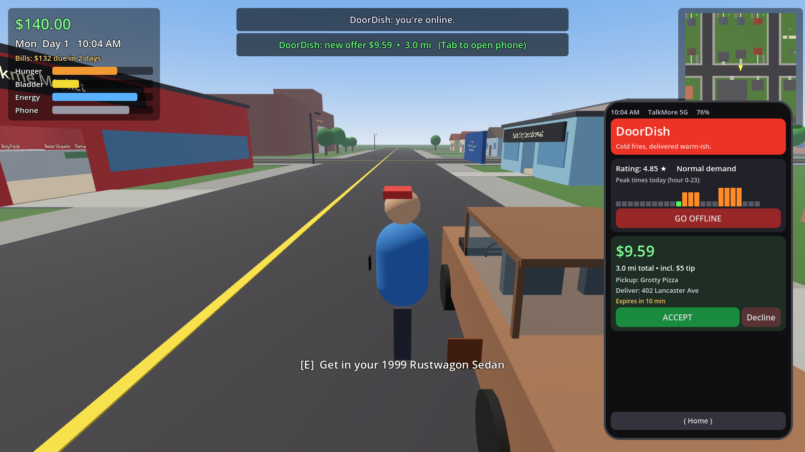
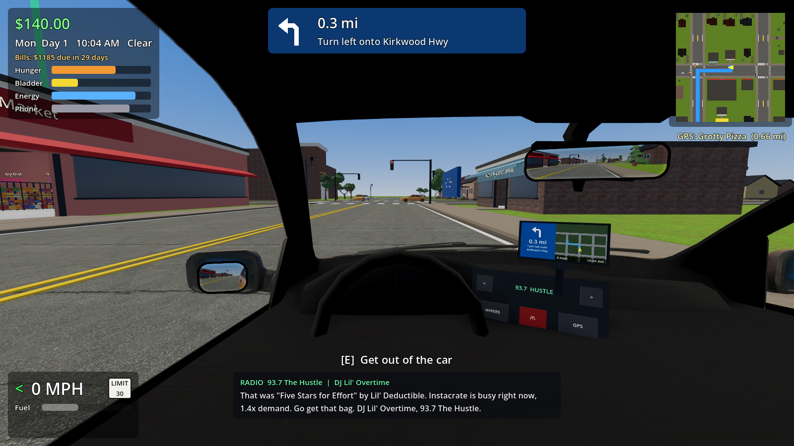
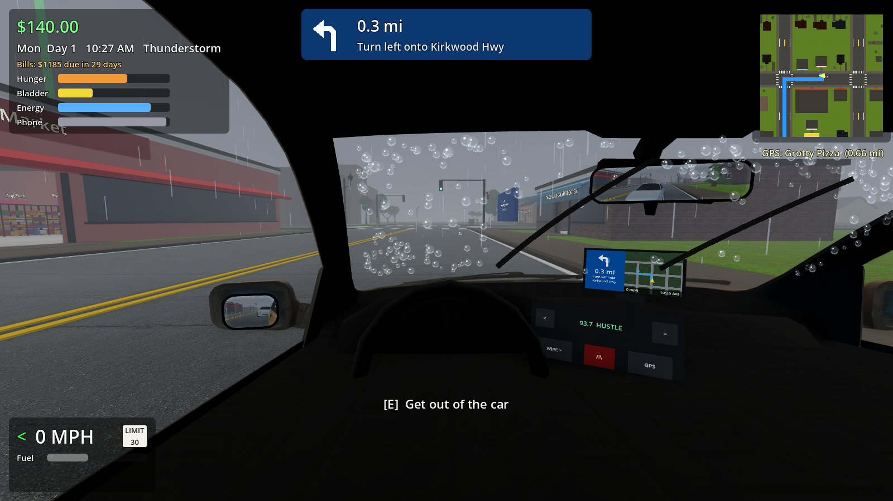
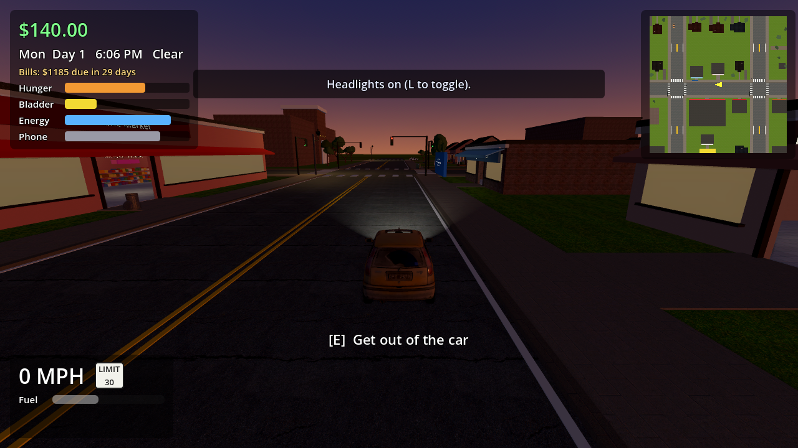
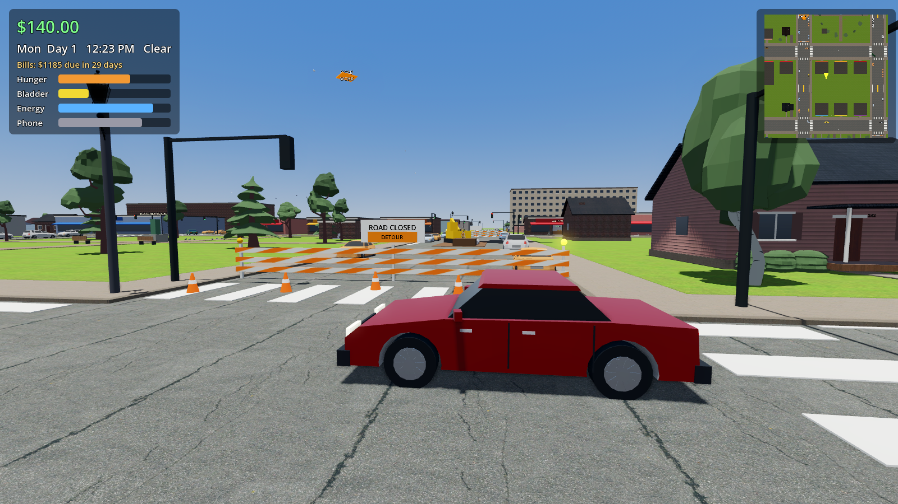
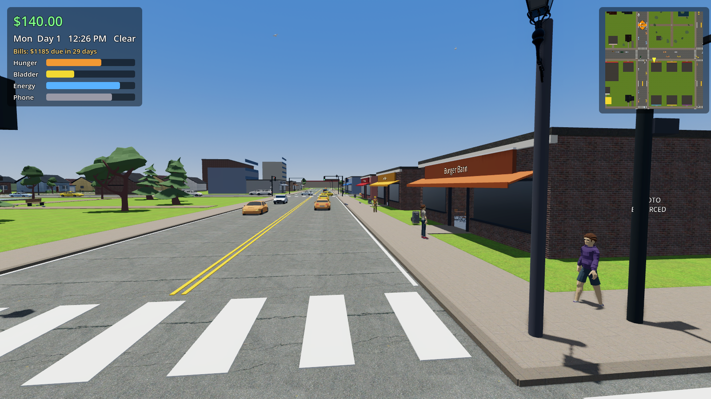

# Side Hustle Sim

A gig-economy life sim made in Godot 4. You start in a beat-up 1995 Fiot Punta GT, renting a room at
Dottie's Boarding House, and grind parody gig apps to pay rent, keep your car alive, and work your
way up to better cars and better homes.

The town, **New Castlewood County**, is a stylized, compressed take on New Castle County, Delaware:
a Wilmingtown-style downtown, a Newark-style college strip (University of Delawhere), suburbs, a
port-side warehouse district, and the I-95 Beltway wrapping it all. Every brand is a parody.






## Running it

1. Install **Godot 4.7** (standard build, not .NET; 4.3+ also works): https://godotengine.org/download
2. Open Godot, click **Import**, and pick this folder's `project.godot`.
3. Press **F5** (or the Play button).

No assets to download: the town is built in code at startup, and the surface textures in
`assets/textures` are generated by `tools/gen_textures.py` (all original, free to use).

## Controls

| Keyboard | Gamepad (Xbox names) | Action |
| --- | --- | --- |
| WASD / arrows | Left stick | Walk, or steer |
| W / S | RT / LT | Gas / brake and reverse |
| Mouse | Right stick | Look around |
| Shift | L3 | Sprint |
| Space | A | Jump / handbrake |
| E | X | Interact, get in or out of the car |
| Tab or P | Y | Phone |
| | B | Back (phone home screen, close menus) |
| C | LB | Driving camera: first person / chase |
| M | D-pad up | Mirrors: in the car / in the car + on screen / off |
| G | D-pad right | Full map (also in the pause menu) |
| L | RB | Headlights |
| R | D-pad down | Flip the car upright |
| H | R3 | Horn |
| Z / X | D-pad left (cycles left, right, off) | Turn signals |
| B | dashboard | Hazard lights |
| V | dashboard | Wipers: off / on / fast |
| N / , | dashboard | Radio: next / previous station (and off) |
| Look at a dash button + E or click | Look + X | Use the dashboard (radio, wipers, hazards, GPS mount) |
| Esc | Start | Pause menu (resume, map, save/load slots, settings, controls, tutorial, new game, quit) |
| F1 | Back | Controls |
| F3 | | Graphics quality: high / low (low is the default on Intel graphics) |
| F5 / F9 | | Save to your current slot / load your latest save |
| F7 / F8 / F6 | | Dev cheats: 10x time speed / +$500 / cycle weather |

With a gamepad, the phone and menus highlight a button: move with the D-pad or left stick,
press A to pick, B to go back. On-screen prompts and the tutorial name whichever you used last
(E or X, Tab or Y, and so on). In first person, the right stick turns your head: push further
to look further (up to about 80 degrees), and it eases back to the road when you let go.

**Tutorial.** The first time you play, a guided tour walks you through the controls, the phone,
your needs, and then drives you (with the GPS) to Lube & Tube, WahWah, a restaurant, the grocery
store, Honest Al's, the Jungle Flex station and your room at Dottie's, ending with your first
gig. Skip or restart it from the pause menu.

## The gig apps

| App | Parody of | How the job works |
| --- | --- | --- |
| **Yoober** | Uber | Drive to the pickup, tap *Start Trip* on the phone, drive to the drop-off, tap *Complete Trip*. Crashes cost stars. Needs a 2011 or newer car. |
| **Drift** | Lyft | Same as Yoober with different peak times and pay. |
| **DoorDish** | DoorDash | Walk into the restaurant, pick up at the *Mobile Pickup* counter, walk the order to the customer's door, take the drop-off photo in the app (you have to be at the door). |
| **Instacrate** | Instacart | Walk the aisles grabbing items on the in-app shopping list, check out at the Instacrate register, deliver, photo. |
| **Jungle Flex** | Amazon Flex | Reserve a block (6 AM, 10 AM, 2 PM, 6 PM), drive into the DNC9 station, scan packages in the app, deliver to a cluster of houses (a photo at each door) before the block ends. |

Each app has its own peak hours, and Fridays and weekends run busier. Peak hours mean more offers
and higher pay.

**Multi-apping.** Stay online on several apps and you can juggle up to 3 jobs at once: one per app,
and only one passenger at a time. Offers come a little slower while you're busy, and every offer
shows when it's due so you can judge whether it fits. The GPS follows one job; switch with *Follow on
GPS* in the phone, and the HUD lists the others with their time left. Shelves, counters and doors
work for any of your jobs, whichever one the GPS is on. Deliver late and you lose stars and pay a
late fee ($1 plus 15 cents a minute, up to half the payout). You get a heads-up 5 minutes before a
job you're juggling is due.

**Heatmaps.** Every app shows a week heatmap of peak times: one row per day, one square per hour,
with the current hour blinking. Every app but Jungle Flex also shows a hot zone map of town: where offers are coming from right now, or 1 to 3 hours ahead. Rides start
in the neighborhoods in the morning and at restaurants and shops in the evening and at night;
DoorDish follows the restaurants; Instacrate follows where customers live. Hot zones send more
offers and pay up to 45% more (shown as *Hot zone +$* on the offer). Each app also has a daily
event (a concert, game day, a street fair) that makes one area hot for 3 hours.

## Life systems

- **Hunger, bladder, energy.** Eat at restaurants, WahWah, or from your fridge. Use restrooms
  (restaurants, stores, the gas station, the park, or home). Sleep in your bed or, badly, in your car.
  Letting them run out has consequences (accidents, passing out, drowsy driving).
- **Monthly bills**: rent, phone, car insurance (and a car loan if you financed). Auto-pay at 9 AM. Miss rent and you get
  evicted; miss the phone bill and your gig apps stop working.
- **Car upkeep**: gas (WahWah), oil changes, tires, and engine repairs (Lube & Tube). Bald tires
  mean less grip, no oil means engine damage.
- **Upgrades**: better cars at Honest Al's Used Cars (cash), or at DriveThyme Auto Finance next
  door (15% down, then 12 monthly payments at 23.9% APR on a marked-up price, so it costs more in
  the end; miss a payment and they repossess it). Better homes at the leasing desks of Maple
  Court, Lakeview Towers, and the Brandywine Hills house.
- **Your place**: each home is in its own neighborhood (Elsmore Flats, Trolly Squared, Christeena
  Riverfront, Brandywine Hills) with its own kitchen (mini fridge, kitchenette, or full kitchen) and
  room for more furniture (4, 7, 11, or 18 pieces). Buy furniture, appliances, and decor in the
  **Wayfare** phone app. It's delivered in boxes by your front door; unbox a piece and walk it
  where you want it (green = fits, red = blocked), R / D-pad down to turn it, E / X to set it down.
  Walk up to a piece later to move, box, or sell it. Better beds sleep better, a microwave or stove
  makes groceries stretch further (up to 10 meals per run) and fills you up more, a coffee maker
  brews 40-cent coffee, and decor adds comfort (up to +15% sleep quality). Your stuff comes with
  you when you move.

**Turn-by-turn GPS.** Any job or Maps waypoint gets a blue route on the minimap and a
next-turn banner at the top of the screen ("Turn left onto Market St, 0.3 mi").

**Map.** Press G (D-pad right on a gamepad), pick Map in the pause menu, or open the
Maps app on your phone. It shows every street, the beltway and Churchmans Loop, an
icon for each place (restaurants, grocery stores, gas, mechanic, car lots, the Jungle
Flex station, housing, restrooms, your home), where you are, and your GPS route. Click
an icon or pick a place from the list to set the GPS there, or click anywhere else to drop a
pin (it snaps to the nearest sidewalk). Right-click clears it. If a job's stop is ahead of your
pin, your pin shows in purple and the GPS takes you there after the job.

**Getting around without your car.** The **Hail Yeah Cab** app on your phone takes you anywhere:
your GPS pin, your parked car, home, or any place on the map ($4 + $2.40 a mile, 25% more from
11 PM to 5 AM, about as long as driving there). The full map has a "Take a cab there" button
once you've set a pin. **DART Last State** buses are cheaper ($2) but slower and only run
between the eight bus stops (pink B on the map), every 15 minutes from 5 AM to midnight. Walk up
to a stop sign and press E. Both skip the trip with a fade: the clock moves on (your needs
too) and you step out on foot. Your car stays where you left it. You can't ride while driving,
during a gig job, or during the tutorial.

**Jumping.** A running split-leg leap: the front leg comes up, the back leg stretches
out, the arms swing opposite, and the knees bend to soak up the landing.

**Mirrors.** In first person, the rearview and side mirrors on the car show live
reflections. Each is a small extra camera view, refreshed in turn to keep it cheap. M (or
Settings) switches between mirrors in the car, in the car plus large copies on screen, and off.

**Police.** Three cop cars patrol with traffic. The speed limit is 30 mph in town and 45 on the
beltway (shown next to your speed). A cop only notices you inside its field of view (ahead and
to the sides, not behind) with a clear line of sight. Speeding more than 7 over, or crashing,
in front of one starts a chase: lights flash and it follows you through the streets. Pull over
and stop to get a ticket ($75 + $10 per mph over, more if you ran). If you can't pay, it becomes
a bill. Get far enough away for long enough and you escape. Running a red light in front of
a cop gets you pulled over too ($150).

**Traffic lights and cameras.** Six downtown intersections have traffic lights, and AI cars
stop for them. Three of those have red light cameras ($100), and five streets (one on the
beltway) have speed cameras ($80 + $6 per mph, past 10 over). Cameras flash and mail you a
ticket as a bill due in a week.

**Phone upgrade.** The Me app sells the Pear uPhone 16 Pro ($350). It shows nearby police on
your minimap (blue COP badges, flashing red when they're after you) and the speed and red light
cameras (orange badges), warns you ("Wayz: speed camera ahead"), and its battery lasts longer.

**Sound.** Engine (revs through the gears), horn, police siren, crash and phone pings, all
synthesized in code at startup (`scripts/audio/sfx.gd`), so there are no audio files. The
background changes with the district you're in (`scripts/audio/ambience.gd`): traffic and
crowd chatter downtown, students on campus, songbirds in the park and the suburbs (crickets
at night), clanks and a backing-up forklift at the port, the roar of the beltway. It's muffled
inside the car or a building.

**Route 40 strip.** Past the beltway on the east side, Churchmans Loop sweeps around in a long
curve lined with fast-food parodies (McDougal's, Burger Monarch, Chick-Fil-Hey, Wendell's, Pizza
Hutch, Taco Bellhop, Domino Effect Pizza, Five Dudes Burgers, Pop-Eyed Chicken, Sub Way Out), a few
shops and the Christiana Maul. The GPS routes over the curved road and AI traffic drives it.

**Apartments with stairs.** Churchmans Crossing is a four-floor building you can walk into: a
lobby, a stairwell and an elevator. Some deliveries go to upstairs doors (Apt 3B and so on), and
the job tells you which floor.

**What you carry.** Orders look like what they are and sit in his hands: a paper takeout bag in
one hand, a pizza box or a parcel held in front with both hands, grocery bags in each hand.

**Weather.** Each day has its own forecast: clear, cloudy, rain, thunderstorms or snow, and
some mornings are foggy. Rain and snow fall around you, the sky goes grey, roads get shiny and
slippery (snow is worst), and snow whitens the grass. Bad weather pays: food delivery offers get
the biggest boost (+30% rain, +45% storm, +50% snow), groceries and rides a bit less, Jungle Flex
only a few percent. The clock line on the HUD shows the current weather.

**Driving feel.**
- *Weather grip.* Wet roads cost a little grip and braking, snow a lot: stops take about 70%
  longer and the rear steps out if you're heavy on the gas in a turn. In the rain, standing water
  can make you hydroplane above about 40 mph (38 in a storm), and worn tires hydroplane sooner
  (bald ones around 30). For a second or so the wheel and gas barely respond. The HUD warns you
  when you're over the hydroplaning speed. Tires squeal (or hiss on wet roads) when you slide.
- *Turn signals* blink on the car and on the HUD, tick, and cancel themselves after a turn.
  Hazards blink all four.
- *Wipers.* Rain and snow build up on the windshield (faster when you drive), creep up the glass
  at speed, and the wipers sweep them off.
- *Dashboard.* A head unit on the center console: radio tune buttons and display, wipers,
  hazards, and the phone mount switch. Look at a button (a dot shows in the middle of the view)
  and press E / X or click.
- *Phone GPS mount.* Your phone sits on a windshield mount showing the next turn, the distance,
  a heading-up map with your route, your speed and the time.
- *Radio.* Five stations, all music synthesized in code: 88.3 Castlewood Public Radio (talk),
  93.7 The Hustle (hip-hop), 97.5 The Breeze (smooth jazz), 99.9 Night Drive (synthwave) and
  104.5 The Pickup (country). DJs back-announce parody songs and tell you which app is busy or
  what the weather is paying; ads for local businesses (Honest Al's, DriveThyme, Lube & Tube,
  WahWah...) and traffic and weather break in. Voices are babble with captions on screen.
  Stations keep playing while you're tuned away. Your station is remembered.




**Day and night.** The sun rises at 6 AM and sets at 6 PM, with an orange glow on the horizon
at dawn and dusk. When it gets dark the streetlights come on, shop windows, houses and apartments
light up, every car in traffic turns on its headlights and taillights, and your own headlights
switch on by themselves (L still toggles them).

**Rush hour and late nights.** On weekdays the roads fill up from 7 to 9 AM and 4 to 6 PM, and
nearly empty out in the small hours (weekends are calmer). From 10 PM to 4 AM, Yoober and Drift
pay a +30% late-night surge (purple bars on the app's peak chart), but about half the riders are
rowdy: they shout and sing along the way, and the ride might end in a big tip, a spilled drink
(the app pays a cleaning fee, but cleaning takes you 15 minutes), a grumpy rating, or a nap.



**People with routines.** Thirty townsfolk each have a home, a role (student, office worker,
shopper, warehouse worker) and a daily plan: leave home in the morning, walk to class or work,
go out for lunch, run errands, stroll, head home in the evening. The streets fill up at lunch
and the evening rush and empty out at night, apart from a few night owls downtown. They cross
at the crosswalks (waiting for the walk light, or a gap in traffic), cars stop for them, and
they go inside the places they visit.

**Jams and honking.** At rush hour most drivers head downtown and it slows to a crawl. Drivers
stuck behind you (double-parked on a delivery, say) lean on the horn after a couple of seconds,
and long jams get honky too.

**Road work.** Every day a couple of cross-street blocks close for construction: barricades with
flashing lamps, ROAD CLOSED / DETOUR signs, cones, an excavator and a crew. The GPS, traffic and
police route around them, the minimap marks them, and the day's closures pop up in the morning.

**Parked cars and birds.** Cars line the curbs of the cross streets (never in front of a
delivery door). Pigeons peck around the park, campus and downtown sidewalks and burst into the
air when you walk up or drive past fast, then circle and land again. Gulls glide over the port.




**Feeling your needs.** When you're tired the picture blurs and darkens at the edges, you start
blinking slowly, and near empty the blinks get long and the view doubles. When you're hungry
the color drains out and your stomach growls now and then (with a little wobble). When you
really need to pee, a yellow pulse creeps in from the edges and you shiver. Settings has a
slider for how strong this is (0 turns it off).

**Save slots.** Three save slots plus an autosave (written when you sleep and at midnight).
Save game and Load game in the pause menu show each slot's day, time, money, car and when it
was saved, with a Delete button. F5 saves to the slot you last used, F9 loads your latest save.
New game (pause menu, press twice) starts over at Dottie's. An old single save from before
slots becomes slot 1.

**Settings** (pause menu): volume, mouse sensitivity, gamepad look speed, invert look,
field of view, fullscreen, VSync, graphics quality, mirrors, screen effects strength, and
autosave. Saved between runs.

All balance numbers (prices, pay, wear rates, need rates) live in `scripts/data/game_data.gd`.

## Project layout

```
project.godot             Godot project (autoloads: Game, Gigs)
scenes/main.tscn          Entry scene, everything else is built in code
scripts/main.gd           Wires world, player, car, HUD, phone; walking <-> driving
scripts/autoload/game.gd  Clock, money, needs, bills, housing, car condition, save/load, input map
scripts/autoload/gigs.gd  Gig apps: online state, offers, peak times, job state machine
scripts/data/game_data.gd All tunable data (cars, homes, apps, menus, rates)
scripts/world/town.gd     Procedural New Castlewood County map, buildings, interiors
scripts/world/kit.gd      Box/label/building/material helpers
scripts/world/gps.gd      Turn-by-turn routing on the street grid
scripts/world/traffic.gd  AI traffic and police on the street grid
scripts/player/humanoid.gd  Quaternius character with a procedural walk cycle
scripts/vehicle/car_model.gd  Car body model (shared by your car and the dealer lot)
tools/gen_textures.py     Generates the tiling PBR textures in assets/textures
scripts/world/interactable.gd  [E]-to-use world objects
scripts/player/player.gd  Third-person character
scripts/vehicle/car.gd    VehicleBody3D car with first-person cockpit
scripts/ui/hud.gd         HUD, minimap, toasts, menus
scripts/ui/phone.gd       The phone and its apps
scripts/ui/pause_menu.gd  Pause menu and settings
scripts/world/pedestrians.gd  People with daily routines, walking the sidewalks and crosswalks
scripts/world/construction.gd Daily road closures (barricades, work zone, detours)
scripts/world/parked_cars.gd  Cars parked along the cross streets
scripts/world/birds.gd    Pigeon flocks and gulls
scripts/world/transit.gd  Bus stops, taxi and bus fares, fast travel
scripts/ui/needs_fx.gd    Screen effects for tiredness, hunger and a full bladder
scripts/audio/sfx.gd      Sound effects synthesized in code
scripts/audio/music.gd    Radio music and DJ babble synthesized in code
scripts/audio/radio.gd    Car radio: stations, DJs, ads, captions
scripts/vehicle/dashboard.gd  Turn signals, hazards, wipers, dash buttons, phone mount
scripts/ui/gps_screen.gd  The mounted phone's GPS screen
scripts/ui/windshield.gd  Rain and snow on the windshield, wiper sweeps
scripts/audio/ambience.gd District soundscapes (synthesized), mixed by place and time of day
scripts/ui/tutorial.gd    Guided first-day tutorial
tests/                    Headless smoke test and screenshot renderer
docs/DESIGN.md            Design doc and roadmap
```

## Tests

```
godot --headless --path . --import
godot --headless --path . res://tests/smoke_test.tscn
```

Boots the game, drives the car, and completes one job in every app, plus bills, eviction, sleep,
shops, and save/load.

## Art credits

All third-party art is CC0 (public domain): photo-scanned textures and street props from
[Poly Haven](https://polyhaven.com), and characters, trees and cars by
[Quaternius](https://quaternius.com) (`assets/quaternius`).

The starter car is based on "(FREE) 1995 Fiat Punto GT"
(https://sketchfab.com/3d-models/free-1995-fiat-punto-gt-48db6facb4b64e99b60f36b8c01185e1)
by Karol Miklas (https://sketchfab.com/karolmiklas), licensed under CC-BY-4.0
(http://creativecommons.org/licenses/by/4.0/). Shown in game as the "Fiot Punta" (`assets/cars/free_1995_fiat_punto_gt`).

The player character and animations come from Adobe Mixamo. Mixamo's terms don't allow
sharing the files on their own, so `assets/mixamo/` is kept out of git; without it the
player uses the Quaternius character.

## Note on names

All app, store, and car names are made-up parodies (Yoober, Drift, DoorDish, Instacrate,
Jungle Flex, WahWah, Ackme, Hondo, Toyoyo, ...). They're meant to be recognizable jokes, not real
brands. If you plan to sell the game, have someone check the final names.
