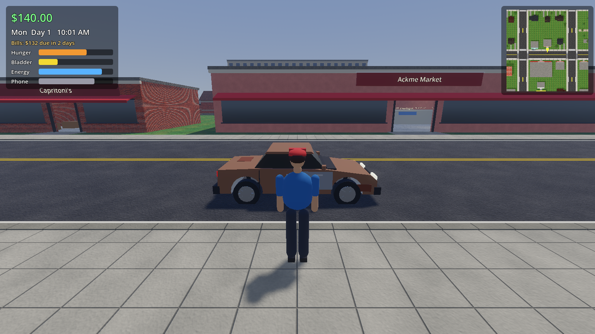
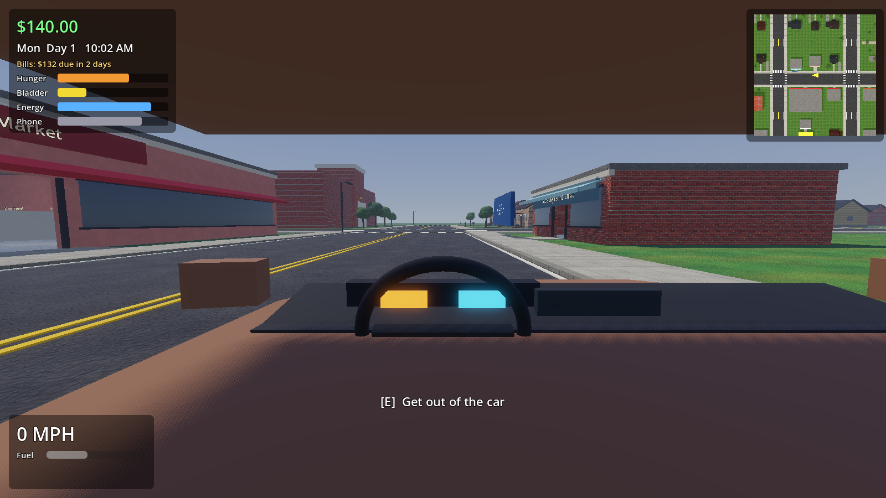
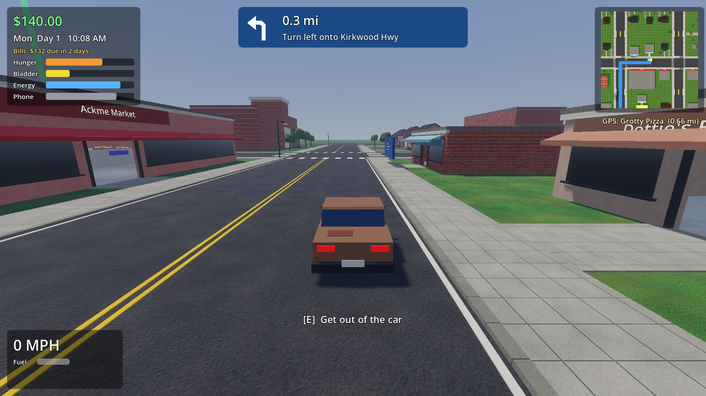
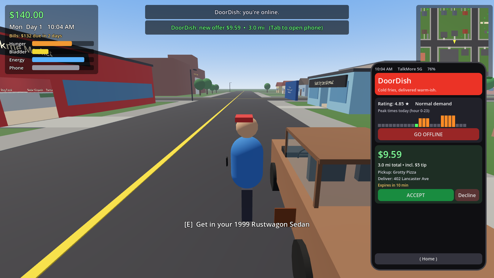

# Side Hustle Sim

A gig-economy life sim made in Godot 4. You start in a beat-up 1999 Rustwagon, renting a room at
Dottie's Boarding House, and grind parody gig apps to pay rent, keep your car alive, and work your
way up to better cars and better homes.

The town, **New Castlewood County**, is a stylized, compressed take on New Castle County, Delaware:
a Wilmingtown-style downtown, a Newark-style college strip (University of Delawhere), suburbs, a
port-side warehouse district, and the I-95 Beltway wrapping it all. Every brand is a parody.






## Running it

1. Install **Godot 4.7** (standard build, not .NET; 4.3+ also works): https://godotengine.org/download
2. Open Godot, click **Import**, and pick this folder's `project.godot`.
3. Press **F5** (or the Play button).

No assets to download: the town is built in code at startup, and the surface textures in
`assets/textures` are generated by `tools/gen_textures.py` (all original, free to use).

## Controls

| Keyboard | Gamepad (Xbox names) | Action |
| --- | --- | --- |
| WASD / arrows | Left stick | Walk, or steer |
| W / S | RT / LT | Gas / brake and reverse |
| Mouse | Right stick | Look around |
| Shift | L3 | Sprint |
| Space | A | Jump / handbrake |
| E | X | Interact, get in or out of the car |
| Tab or P | Y | Phone |
| | B | Back (phone home screen, close menus) |
| C | LB | Driving camera: first person / chase |
| M | D-pad up | Mirrors on / off |
| L | RB | Headlights |
| R | D-pad down | Flip the car upright |
| H | R3 | Horn |
| Esc | Start | Pause menu (resume, controls, save/load, graphics, tutorial, quit) |
| F1 | Back | Controls |
| F3 | | Graphics quality: high / low (low is the default on Intel graphics) |
| F5 / F9 | | Save / load |
| F7 / F8 | | Dev cheats: 10x time speed / +$500 |

With a gamepad, the phone and menus highlight a button: move with the D-pad and press A.

**Tutorial.** The first time you play, a guided tour walks you through the controls, the phone,
your needs, and then drives you (with the GPS) to Lube & Tube, WahWah, a restaurant, the grocery
store, Honest Al's, the Jungle Flex station and your room at Dottie's, ending with your first
gig. Skip or restart it from the pause menu.

## The gig apps

| App | Parody of | How the job works |
| --- | --- | --- |
| **Yoober** | Uber | Drive to the pickup, tap *Start Trip* on the phone, drive to the drop-off, tap *Complete Trip*. Crashes cost stars. Needs a 2011 or newer car. |
| **Drift** | Lyft | Same as Yoober with different peak times and pay. |
| **DoorDish** | DoorDash | Walk into the restaurant, pick up at the *Mobile Pickup* counter, walk the order to the customer's door, take the drop-off photo in the app. |
| **Instacrate** | Instacart | Walk the aisles grabbing items on the in-app shopping list, check out at the Instacrate register, deliver, photo. |
| **Jungle Flex** | Amazon Flex | Reserve a block (6 AM, 10 AM, 2 PM, 6 PM), drive into the DNC9 station, scan packages in the app, deliver to a cluster of houses before the block ends. |

Each app has its own peak hours (shown as a bar chart in the app). Peak hours mean more offers and
higher pay.

## Life systems

- **Hunger, bladder, energy.** Eat at restaurants, WahWah, or from your fridge. Use restrooms
  (restaurants, stores, the gas station, the park, or home). Sleep in your bed or, badly, in your car.
  Letting them run out has consequences (accidents, passing out, drowsy driving).
- **Bills every 3 days**: rent, phone, car insurance. Auto-pay at 9 AM. Miss rent and you get
  evicted; miss the phone bill and your gig apps stop working.
- **Car upkeep**: gas (WahWah), oil changes, tires, and engine repairs (Lube & Tube). Bald tires
  mean less grip, no oil means engine damage.
- **Upgrades**: better cars at Honest Al's Used Cars, better homes at the leasing desks of Maple
  Court, Lakeview Towers, and the Brandywine Hills house.

**Turn-by-turn GPS.** Any job or Maps waypoint gets a blue route on the minimap and a
next-turn banner at the top of the screen ("Turn left onto Market St, 0.3 mi").

**Mirrors.** In first person, your car has a working rearview mirror (top center) and side
mirrors (left and right). Each is a small extra camera view, refreshed in turn to keep it cheap.

**Police.** Three cop cars patrol with traffic. The speed limit is 30 mph in town and 45 on the
beltway (shown next to your speed). A cop only notices you inside its field of view (ahead and
to the sides, not behind) with a clear line of sight. Speeding more than 7 over, or crashing,
in front of one starts a chase: lights flash and it follows you through the streets. Pull over
and stop to get a ticket ($75 + $10 per mph over, more if you ran). If you can't pay, it becomes
a bill. Get far enough away for long enough and you escape.

**Phone upgrade.** The Me app sells the Pear uPhone 16 Pro ($350). It shows nearby police on
your minimap (blue COP badges, flashing red when they're after you), and its battery lasts longer.

**Sound.** Engine (revs through the gears), horn, police siren, crash, phone pings and a
quiet town ambience, all synthesized in code at startup (`scripts/audio/sfx.gd`), so there are
no audio files.

**Pedestrians** walk the sidewalks around the blocks, stopping now and then and when you're in
their way.

**Settings** (pause menu): volume, mouse sensitivity, gamepad look speed. Saved between runs.

All balance numbers (prices, pay, wear rates, need rates) live in `scripts/data/game_data.gd`.

## Project layout

```
project.godot             Godot project (autoloads: Game, Gigs)
scenes/main.tscn          Entry scene, everything else is built in code
scripts/main.gd           Wires world, player, car, HUD, phone; walking <-> driving
scripts/autoload/game.gd  Clock, money, needs, bills, housing, car condition, save/load, input map
scripts/autoload/gigs.gd  Gig apps: online state, offers, peak times, job state machine
scripts/data/game_data.gd All tunable data (cars, homes, apps, menus, rates)
scripts/world/town.gd     Procedural New Castlewood County map, buildings, interiors
scripts/world/kit.gd      Box/label/building/material helpers
scripts/world/gps.gd      Turn-by-turn routing on the street grid
scripts/world/traffic.gd  AI traffic and police on the street grid
scripts/player/humanoid.gd  Quaternius character with a procedural walk cycle
scripts/vehicle/car_model.gd  Car body model (shared by your car and the dealer lot)
tools/gen_textures.py     Generates the tiling PBR textures in assets/textures
scripts/world/interactable.gd  [E]-to-use world objects
scripts/player/player.gd  Third-person character
scripts/vehicle/car.gd    VehicleBody3D car with first-person cockpit
scripts/ui/hud.gd         HUD, minimap, toasts, menus
scripts/ui/phone.gd       The phone and its apps
scripts/ui/pause_menu.gd  Pause menu and settings
scripts/world/pedestrians.gd  People walking the sidewalks
scripts/audio/sfx.gd      Sound effects synthesized in code
scripts/ui/tutorial.gd    Guided first-day tutorial
tests/                    Headless smoke test and screenshot renderer
docs/DESIGN.md            Design doc and roadmap
```

## Tests

```
godot --headless --path . --import
godot --headless --path . res://tests/smoke_test.tscn
```

Boots the game, drives the car, and completes one job in every app, plus bills, eviction, sleep,
shops, and save/load.

## Art credits

All third-party art is CC0 (public domain): photo-scanned textures and street props from
[Poly Haven](https://polyhaven.com), and characters, trees and cars by
[Quaternius](https://quaternius.com) (`assets/quaternius`).

## Note on names

All app, store, and car names are made-up parodies (Yoober, Drift, DoorDish, Instacrate,
Jungle Flex, WahWah, Ackme, Hondo, Toyoyo, ...). They're meant to be recognizable jokes, not real
brands. If you plan to sell the game, have someone check the final names.
